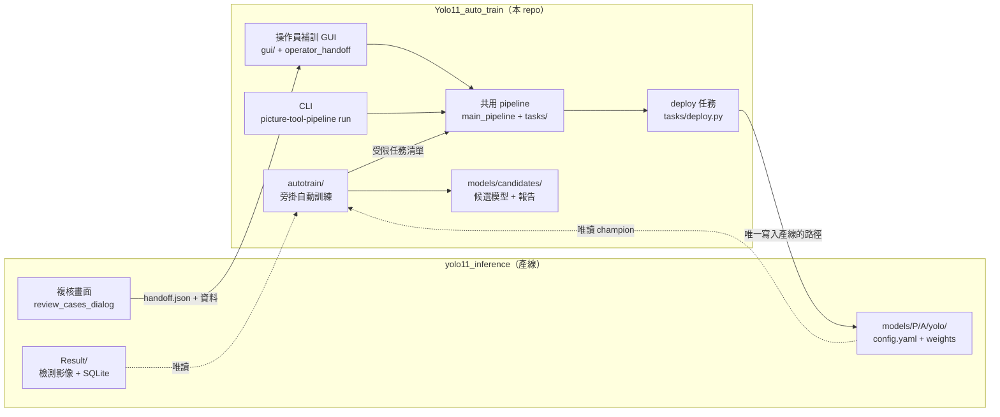
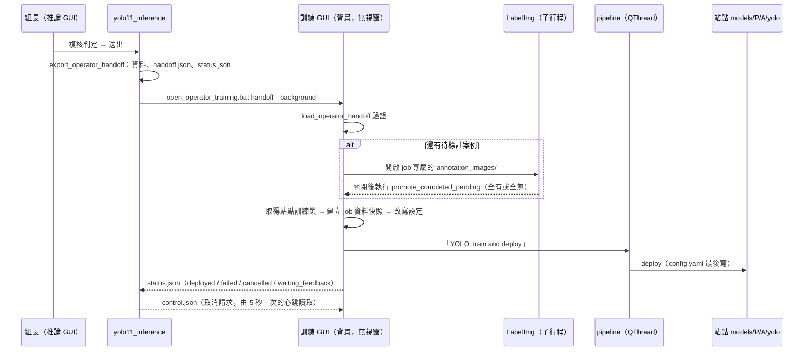

# Yolo11_auto_train 架構

> **對象**：第一次接手訓練端程式、或要修改訓練／部署行為的工程師。
> **核對基準**：2026-10-06，分支 `feature/autonomous-training-phase1`，commit `cc8f644`。
> 本文每一項說法都對過原始碼；檔案位置以 `檔案:行號` 標示，程式改動後行號可能偏移。
> 推論端的對應文件是
> [`yolo11_inference/docs/architecture/MODULE_ARCHITECTURE_ZH_TW.md`](../../yolo11_inference/docs/architecture/MODULE_ARCHITECTURE_ZH_TW.md)。

## 0. 先讀這一段

- 套件名稱是 `picture_tool`（`src/picture_tool/`，約 5.4 萬行，其中約 4,800 行是內嵌的 LabelImg）。
- 所有訓練都走**同一條 pipeline**（`main_pipeline.run_pipeline`），由三個入口驅動：
  1. **操作員補訓 GUI**：推論端送來交接檔（handoff）後在背景執行，這是現場主要路徑。
  2. **CLI** `picture-tool-pipeline run`：工程師手動使用。
  3. **autotrain**：旁掛式自動訓練，只能跑受限的任務清單。
- **只有 `deploy` 任務會寫入產線**（`yolo11_inference/models/<產品>/<站別>/yolo/`）。它是一個有 journal 的交易，最後才寫 `config.yaml`；只要任何一道 Gate 沒過，產線模型就不會被動到。
- autotrain 只會產生「候選模型」與報告，**永遠不部署**。
- 兩個 repo 之間沒有 Python import，只透過檔案與子行程溝通（見 §1）。

建議閱讀順序：§1（和推論端的邊界）→ §2（入口）→ §3（套件地圖）→ §6（操作員主流程）→ §7（部署與 Gate）。其他章節需要時再查。



---

## 1. 和 yolo11_inference 的邊界

兩個 repo 各自發版，彼此不 import，靠以下合約對接。修改任何一項，都要同時檢查另一邊的讀寫端。

| 合約 | 方向 | 訓練端 | 推論端 |
|---|---|---|---|
| **`workspace.yaml`**：跨專案路徑 | 雙方各自解析 | `workspace_paths.py` | `core/workspace.py` |
| **操作員交接**：`data/.operator_handoff/jobs/<job_id>/handoff.json`（schema 1–6） | 推論寫，訓練讀 | `gui/operator_handoff.py` | `tools/export_review_dataset.py::export_operator_handoff` |
| **工作狀態**：同目錄的 `status.json` | 訓練是唯一寫入者 | `operator_job.py` | `app/gui/model_update_status_dialog.py` 讀取 |
| **取消請求**：同目錄的 `control.json` | 推論寫，訓練讀 | `operator_job.refresh_operator_job_lease` | `tools/operator_job_control.py` |
| **啟動訓練**：`open_operator_training.bat <handoff> --background` | 推論啟動訓練行程 | `gui/app.py` | `app/gui/training_launcher.py` |
| **可攜補訓包**（zip，換一台電腦補訓用） | 推論匯出，訓練匯入 | `portable_training_package.py` | `tools/portable_training_package.py` |
| **站點模型目錄** `models/<P>/<A>/yolo/` | 訓練寫（deploy），推論讀 | `tasks/deploy.py` | `core/services/model_manager.py`、`model_version_registry.py` |
| **模型驗收 Gate** | 訓練以子行程呼叫推論的 runner | `tasks/deploy.py`（約 :1223–1512） | `python -m app.acceptance.headless` → `core/services/acceptance_gate.py` |
| **驗收快照** `<station_data>/acceptance/P/A/snapshots/<id>/` | 推論寫，訓練讀 | `gui/operator_handoff.py` | `core/services/model_acceptance.py` |
| **共用鎖**：`.deploy.lock/`、`deployment-publication.lock` | 雙方都會取用 | `tasks/deploy.py` | `core/services/model_config_editor.py`、`tools/color_revision_publication_lock.py` |
| **站點專屬欄位清單**（部署時保留的 19 個欄位） | 兩邊各有一份 | `tasks/deploy.py:52-85` | `core/services/model_version_registry.py:30-58` |
| **顏色一致性 fixture**：`tests/fixtures/color_conformance.json` | 兩份內容逐位元組相同 | `tests/test_color_conformance.py` | 同名測試 |
| **顏色門檻校正**：`threshold_calibration.py` | 推論**依檔案路徑**載入訓練端這支檔案 | `color/threshold_calibration.py` | `tools/color_calibration_service.py:146-224` |

Workspace 層的 CI 會驗證幾件事：兩邊對 `workspace.yaml` 的解析結果一致、兩份顏色 fixture 完全相同、兩個子 repo 的 commit 都已通過各自的 CI。

### 1.1 `workspace.yaml` 的解析順序（`workspace_paths.py`）

1. 若有環境變數 `YOLO11_WORKSPACE_ROOT`，該目錄必須包含 `workspace.yaml`，否則直接報錯，**不會**往下找。
2. 從訓練 repo 根目錄往上找最近的 `workspace.yaml`。
3. 舊版相鄰目錄布局：`Yolo11_auto_train` 和 `yolo11_inference` 放在同一層。
4. 以上都找不到時，拋出 `WorkspaceConfigurationError`。

只有 autotrain、`runtime_pair_deployment`、`gui/operator_handoff`（schema 6）用到 `WorkspacePaths`。
pipeline 和 deploy 的 `inference_models_dir` 則寫死在設定檔裡（`../yolo11_inference/models`），**以目前工作目錄為基準解析**，不經過 `workspace.yaml`。

---

## 2. 入口點

| 入口 | 實際呼叫 | 用途 |
|---|---|---|
| `open_operator_training.bat` | `python -m picture_tool.gui.app` | 現場主入口。參數：`<handoff> [--background]`、`--import <zip>`、`--open`、不帶參數則等於 `--resume-latest`、`--check` |
| `import_operator_training.bat <zip>` | 轉呼叫上一個 bat 並帶 `--import` | 匯入可攜補訓包 |
| `run_autotrain.bat` | `python -m picture_tool.autotrain.runner` | 無人值守的 autotrain；不需要 typer。結束碼：0 正常、1 有批次被拒或失敗、2 未啟用 |
| `picture-tool-gui` | `gui.app:main` | 同 GUI |
| `picture-tool-pipeline` | `main_pipeline:main` → `cli.app`（Typer） | 子指令 `run`、`list-tasks`、`describe`、`anomalib-train-folder` |
| `picture-tool-autotrain` | `autotrain.cli:app`（Typer） | autotrain 的人工操作與查詢 |
| `picture-tool-runtime-pair` | `runtime_pair_deployment:main` | 驗證或發布在 pipeline 之外訓練的 ONNX＋PT 成對模型 |
| `picture-tool-color-verify` / `picture-tool-color-calibrate` | `color/…` | 離線顏色驗證／門檻建議 |
| `picture-tool-anomalib` | `anomalib_cli:main`（argparse） | Anomalib 訓練、打包、部署 |
| `picture-tool-dataset-inventory` | `dataset_inventory:main` | 唯讀盤點 `data/`，找出重複與 split 洩漏 |
| `picture-tool-doctor` | `doctor:main` | 環境檢查；三個 bat 啟動前都會先跑 `--runtime-only` |

三個 bat 都會設定 `YOLO_CONFIG_DIR=data\.ultralytics` 和 `PYTHONPATH=src`。
Python 的搜尋順序是：`PICTURE_TOOL_PYTHON` → `.venv` → 兩個固定的 conda 環境 → PATH 上的 `python`。

**CLI 正確用法**（舊文件寫的 `--tasks full` 是錯的，會被拒絕）：

```powershell
picture-tool-pipeline run --config configs/default_pipeline.yaml --task-groups full
picture-tool-pipeline run --config configs/default_pipeline.yaml --tasks yolo_train --force
picture-tool-pipeline run --config ... --tasks dataset_splitter --tasks yolo_train   # 多個任務要重複寫旗標
picture-tool-pipeline list-tasks --config configs/default_pipeline.yaml
picture-tool-pipeline describe yolo_train
```

> 2026-10-06 實查：現場的 conda 環境（`anomalib_env`、`yolo_anomalib`）**沒有安裝 typer**，
> 雖然 `pyproject.toml` 有宣告這個依賴。所以 `picture-tool-pipeline` 和 `picture-tool-autotrain`
> 在那兩個環境無法執行；現場實際使用的入口是 GUI 和 `run_autotrain.bat`。

`serve.py`（FastAPI 推論服務）不是 console script，只有 `deploy/Dockerfile*` 會用到它，見 §13。

---

## 3. 套件地圖

依職責分層。箭頭方向代表「上層呼叫下層」；下層不會反過來 import 上層。

| 層 | 模組 | 職責 |
|---|---|---|
| **介面** | `gui/`、`cli.py`、`autotrain/cli.py`、`anomalib_cli.py`、`doctor.py` | 人或排程呼叫的入口 |
| **人在迴圈** | `gui/operator_handoff.py`、`pending_annotations.py`、`operator_job.py`、`operator_acceptance.py`、`portable_training_package.py`、`libs/labelImg/` | 驗證交接、補標、晉升標註、工作鎖與狀態、匯入補訓包 |
| **旁掛子系統** | `autotrain/`（30 項）、`bootstrap/`（9 個模組，只有 `scripts/` 會呼叫） | 自動挑樣本、候選訓練與評估；冷啟動標註實驗 |
| **編排** | `main_pipeline.py`、`pipeline/`、`tasks/` | 任務註冊、依賴排序、跳過判斷、逐一執行 |
| **設定與路徑** | `config_loader.py`、`config_validation.py`、`path_resolver.py`、`workspace_paths.py` | 載入 YAML、寬鬆驗證、依產品改寫路徑、找出 workspace |
| **發布** | `tasks/deploy.py`、`tasks/deployment_target.py`、`runtime_pair_deployment.py`、`tasks/bundle.py` | Gate 複核與交易式部署；成對模型證明；未經 Gate 的 zip |
| **領域建構塊** | `split/`、`augment/`、`quality/`、`train/`、`eval/`、`infer/`、`report/`、`position/`、`color/`、`anomaly/`、`format/` | 被 `tasks/` 包裝成任務的實作 |
| **共用低層** | `utils/`、`tracking/`、`dataset_manifest_lock.py`、`exceptions.py`、`exception_notes.py`、`constants.py` | ONNX 匯出、雜湊、實驗紀錄、跨行程鎖 |

幾個容易搞混的名字：

- **`path_resolver`** 和 **`workspace_paths`**：前者把設定改寫成 `data/<P>/<A>/…` 與 `runs/<P>/<A>/…`（以 cwd 為基準）；後者找出兩個 repo 和共用資料夾的位置。
- **`utils/model_manager.py`** 和推論端的 **`core/services/model_manager.py`**：前者是沒人使用的 LRU 快取；後者才是推論端真正載入站點設定的類別。
- **`tasks/bundle.py`** 和 **`portable_training_package.py`**：方向相反，見 §7.4。
- **`autotrain/golden.py`** 和 **`autotrain/golden_candidates.py`**：前者註冊並鎖定 golden set；後者只產出一份「候選清單」給人看，**永遠不會**直接建立 golden set。

---

## 4. Pipeline 引擎

### 4.1 運作方式

- **`Task`**（`pipeline/core.py:8-28`）有五個欄位：`name`、`run(config, args)`、`dependencies`、`skip_fn(config, args) -> 原因或 None`、`description`。
- **註冊**：`main_pipeline.build_task_registry`（:132-158）依序讀取 7 個 `tasks/*` 模組的 `TASKS`，以名稱為 key；同名時後讀到的覆蓋先讀到的。
- **依賴**：**只有程式碼裡的 `Task.dependencies` 算數**。YAML `pipeline.tasks[].dependencies` 不會被任何程式讀取。
- **執行**（`Pipeline.run`）：
  1. DFS 補齊依賴並做拓撲排序。
  2. 每個任務執行前跑一個 before-task hook：如果設定檔 mtime 有變就熱重載 → 重新做 schema 驗證 → 套用 CLI／GUI 覆寫與 `path_resolver` → 自動選擇 device。
  3. 呼叫 `skip_fn`；有回傳原因就跳過。
  4. 執行 `run`；拋出例外時，後續任務全部中止。
- **停止**：`args.stop_event` 在任務之間檢查一次；YOLO 訓練另外在 epoch／batch 結束時檢查。
- **快取**：`pipeline/cache.py` 把 `.task_metadata.json` 寫在輸出目錄。雜湊的是「相對路徑＋檔案大小＋mtime」的 MD5，**不是檔案內容**。
- **`force`**：`--force` 或 `pipeline.force` 會停用所有 `skip_fn`。
- **Preflight**（`pipeline/preflight.py`）：**只有 GUI 會跑**，CLI 和 autotrain 都不會。

### 4.2 已註冊的 20 個任務

| 任務 | 模組 | 依賴 | 產出（以 `--product P,A` 解析後的路徑） |
|---|---|---|---|
| `format_conversion` | conversion | – | `processed/images_converted`（下游沒有任務使用） |
| `yolo_augmentation` | augmentation | – | `processed/{images,labels}` |
| `image_augmentation` | augmentation | – | `processed/augmented_preview`（下游沒有任務使用） |
| `aug_preview` | augmentation | – | `runs/P/A/quality/preview/preview.png` |
| `anomaly_detection` | quality | – | `processed/anomaly_results`（傳統統計法，和 Anomalib 無關） |
| `dataset_splitter` | quality | – | `split/{train,val,test}`、`training_provenance.json` |
| `dataset_lint` | quality | – | `lint.csv`、`summary.md`（只回報，不擋流程） |
| `generate_report` | quality | – | `runs/P/A/reports/report_*/report.md` |
| `batch_inference` | quality | – | `runs/P/A/infer/predictions.csv` |
| `qc_summary` | quality | – | `qc_summary.json` |
| `color_inspection` | quality | – | 互動式 SAM 視窗 → 顏色 `stats.json` |
| `color_verification` | quality | – | 離線顏色驗證報告 |
| `yolo_train` | training | `dataset_splitter` | `runs/P/A/trainN/`，其中有 weights、`last_run_metadata.json`、`auto_position_config.yaml`、ONNX、`detection_config.yaml` |
| `yolo_evaluation` | training | `yolo_train` | `<run>/evaluation_gate.json`（每次都重跑） |
| `position_validation` | training | – | `position_validation.json`；可選擇另寫 `<run>/position_gate.json` |
| `anomalib_train` | training | – | `runs/anomalib/…/*.ckpt` |
| `anomalib_package` | training | – | `runs/anomalib_packages/*.zip` |
| `data_sync` | data_sync | – | `dvc pull`（repo 沒有 `.dvc/`，所以實際上什麼都不做） |
| `artifact_bundle` | bundle | – | `<product>_<dir>.zip`，未經任何 Gate |
| `deploy` | deploy | `yolo_evaluation` | 寫入產線站點目錄，見 §7 |

程式碼裡只有一條依賴鏈：`deploy → yolo_evaluation → yolo_train → dataset_splitter`。

設定檔的任務群組（`configs/default_pipeline.yaml`）：`preprocess`、`augmentation`、`split`、`train`、`anomalib`、`inference`、`quality`、`full`。
`full` **不含** `deploy`、`artifact_bundle`、`data_sync`。
現場補訓使用的是 GUI 寫死在程式裡的預設流程「YOLO: train and deploy」（`gui/workflows.py:53-72`）：augmentation → lint → split → train → position_validation → evaluation → report → batch_inference → qc_summary → deploy。

### 4.3 設定

- `config_loader.load_config`：**檔案不存在時會靜默改用**套件內建的 `picture_tool/resources/default_pipeline.yaml`。
- `config_validation`：Pydantic v2，非 strict 模式，**只記警告**，不回填預設值。
- 設定檔的選擇方式：GUI 和 autotrain 用 `configs/<product 小寫>_pipeline.yaml`，找不到時退回 `configs/default_pipeline.yaml`。
- `configs/autonomous_training.yaml` 是 autotrain 的開關，預設 `enabled: false`。

---

## 5. 資料與輸出目錄

```text
Yolo11_auto_train/
├─ data/                                   ← workspace.yaml 的 training_data
│  ├─ <P>/<A>/
│  │  ├─ raw/{images,labels}               ← 人工確認過的標註（labels/classes.txt 定義類別）
│  │  ├─ processed/{images,labels}         ← yolo_augmentation 輸出
│  │  ├─ split/{train,val,test}/…          ← dataset_splitter 輸出 + training_provenance.json + data.yaml
│  │  ├─ metadata/review_dataset_manifest.csv   ← 每張補訓影像的來源與狀態
│  │  └─ review_pending/{images,labels,manifest.csv}  ← 待補標的案例
│  ├─ .operator_handoff/                   ← 交接工作、鎖、latest.json
│  ├─ .autotrain/                          ← autotrain 的所有狀態（§8）
│  ├─ .portable_models/、.portable_imports/ ← 可攜補訓包的站點副本與匯入收據
│  └─ .ultralytics/                        ← YOLO_CONFIG_DIR
├─ runs/<P>/<A>/{train,train2,…, quality, reports, infer, logs}
├─ models/candidates/<P>/<A>/<ver>/        ← autotrain 候選模型（manifest.json + weights）
├─ reports/experiments/{train,eval}-<ts>.{yaml,json}   ← 每次訓練／評估都寫，沒有清理機制
└─ mlruns/                                 ← MLflow（configs 預設開啟）
```

**資料溯源**（哪些影像訓練出哪個模型）：

1. `dataset_splitter` 寫出 `training_provenance.json`，內容是每張影像的 sha256，加上以內容定址的 `dataset_id`。
2. 訓練器把 `dataset_id` 複製進 `last_run_metadata.json`。
3. deploy 再把這兩者帶到站點的 `versions/<ver>.provenance.json` 和 `deployment_manifest.yaml`。

`last_run_metadata.json` 裡的 `dataset_hash` 只供「是否跳過重訓」判斷，**不能**當作資料身分：它雜湊的是 mtime，任何一次重新切分都會讓它改變。

---

## 6. 主流程 A：操作員補訓（人在迴圈）



| 步驟 | 負責模組 | 重點 |
|---|---|---|
| 1. 推論端建立工作 | 推論 `tools/export_review_dataset.py` | 資料寫進訓練端的 `data/<P>/<A>/`，工作檔寫在 `data/.operator_handoff/jobs/<job_id>/` |
| 2. 驗證交接 | `gui/operator_handoff.load_operator_handoff` | schema 1–6。schema 6 要求四個路徑都和 `workspace.yaml` 一致；樣本 ID 會和 manifest 對帳；類別 schema 的 sha256 必須相符；只能有一個 target |
| 3. 操作員介面 | `gui/main_window._set_operator_mode` | 隱藏工程功能，只在有待標註案例時顯示標註分頁。**訓練 GUI 本身沒有 PIN**，PIN 在推論端 |
| 4. 補標 | `pending_annotations.configure_pending_job_workspace`、`gui/labelimg_launcher.py` | 只複製這個 job 的待標註影像，檔名加上工作前綴（`1-補框`、`2-刪錯框`、`3-改類別`、`4-調整框`、`5-待確認`）。前綴是本模組加的，不是 LabelImg 的功能 |
| 5. 晉升標註 | `pending_annotations.promote_completed_pending` | 先驗證**全部**列：任一張不合法，這一輪就不加入任何資料。通過後以原子寫入複製進 `raw/`、改寫 manifest，最後清掉待標註的證據 |
| 6. 鎖與快照 | `operator_job.acquire_target_training_lock`、`operator_handoff.materialize_job_dataset_snapshot` | 每個 `<P>--<A>` 一把鎖。資料複製進 job 專屬的 `dataset/`，並做衝突與重複分析，有衝突就停 |
| 7. 改寫設定 | `operator_handoff.apply_handoff_to_config` | 只用不改色的增強；val ≥ 5、test ≥ 10；以部署中的 `.pt` 做 fine-tune（sha256 必須和 manifest 一致）；加上各道 Gate 門檻（§7.1） |
| 8. 執行 | `gui/pipeline_manager.py` → `gui/task_thread.WorkerThread` | QThread 內執行 `run_pipeline`。GUI 只負責把任務名稱對應成狀態與進度 |
| 9. 結束 | `main_window.on_pipeline_finished/error` | 寫入最終狀態、釋放鎖、顯示 `operator_acceptance` 摘要；背景模式下直接結束行程 |

**`status.json` 的狀態**：`queued` → `waiting_annotation` → `preparing_dataset` → `training` → `evaluating` → `deploying` → `deployed`。
另有 `cancelling`、`cancelled`、`waiting_feedback`（資料不足）、`failed`。
心跳每 5 秒一次，逾時判定為 45 秒；站點鎖是否過期，依 PID＋行程建立時間判斷，遠端主機則用 10 分鐘的 lease。

**取消**：

- 還在等標註時：直接把狀態改成 `cancelled`。
- 訓練中：設定 stop event，在任務之間或 epoch 結束時停下。
- `deploy` **不會**檢查 stop event。正在部署時送出的取消請求擋不下發布，但狀態仍會回報 `cancelled`（見 §14）。

---

## 7. 發布：deploy 任務與 Gate

### 7.1 發布前必須通過的 Gate

| # | Gate | 證據檔 | 現場（操作員）設定 |
|---|---|---|---|
| 1 | **評估 Gate**：新舊模型在同一個 test split 上比較 | `<run>/evaluation_gate.json`（`eval/yolo_evaluator.py`） | P ≥ 0.80、R ≥ 0.90、mAP50 ≥ 0.80、mAP50-95 ≥ 0.50；比部署中的模型最多退步 0.02；conf 0.40 |
| 2 | **位置 Gate**：golden OK／NG 影像的離線位置檢查 | `<run>/position_gate.json`（`position/position_gate.py`） | OK 樣本 ≥ 10、誤殺率 ≤ 0.5%、退步 ≤ 0.01；校正影像不得出現在 golden set（以 sha256 比對） |
| 3 | **Runtime 溯源**：ONNX 和 PT 的 sha256 必須與 `runtime_export_manifest.json` 一致 | 同左 | 一律檢查 |
| 4 | **ONNX／PT 數值等價**：同一個隨機張量分別跑兩個模型，比較輸出 | 內嵌在 manifest 的 `runtime_pair_verification` | rtol／atol 都是 1e-3 |
| 5 | **模型驗收 Gate**：凍結的驗收集逐張重播，新舊模型逐張比較 | `versions/<ver>.model_acceptance.json` | handoff schema ≥ 6 才強制；不允許任何退步 |
| 6 | **顏色前置條件**：`color_checker_type: stats` 時 | – | 不發布訓練端的 `stats.json`；站點必須已經有核准過的基準檔 |

另外兩項檢查：版本號不得重複；部署過程中站點 `config.yaml` 不得被別人改過（驗收 Gate 跑完後檢查一次，寫入前再檢查一次）。

### 7.2 `run_deploy` 的交易（`tasks/deploy.py`）

1. **準備**：解析目標與路徑，找到 run 目錄，必要時補做 ONNX 匯出，載入並複核 Gate 1–4 的證據。
2. **取鎖**：建立 `yolo/weights/`，取得站點鎖 `.deploy.lock/`（mkdir 鎖，推論端的設定編輯器和版本切換也用同一把）。
3. **決定版本與設定**：版本名稱為 `<P>_<A>_v<x.y.z>_<YYYYMMDD>.<ext>`。合併設定時保留**站點專屬欄位**（相機、顏色等），並決定位置契約要驗證、保留或停用。
4. **驗收 Gate**（Gate 5）：以子行程呼叫推論端的 headless runner。
5. **開啟交易並寫入權重**：寫入版本化權重、成對 `.training.pt`、別名（`best.onnx` 等）與顏色檔，每個檔案都以「temp 檔＋replace」寫入，並記錄在 rollback journal。
6. **寫入證據與 manifest**：取得 `deployment-publication.lock`，複核驗收報告與顏色修訂，再寫入 `versions/` 證據、`deployment_manifest.yaml` 和權重旁的 `.manifest.yaml`。
7. **提交點**：再確認一次站點設定沒變，然後**最後才寫 `config.yaml`**（:2264-2273）。在這之前，推論端讀到的一直是舊權重。
8. **收尾**：成功就刪掉 rollback 目錄；任何 `BaseException` 都依 journal 還原全部檔案。

**寫入站點的檔案**：

- `weights/` 底下：版本化權重、`.training.pt`、別名、`*.manifest.yaml`。
- `versions/<ver>.{config.yaml, provenance.json, model_acceptance.json, position_*.json}`。
- `deployment_manifest.yaml`、`config.yaml`。

舊版本永遠不會被刪除或覆寫。**退回舊版本由推論端負責**：`core/services/model_version_registry.activate` 依 `versions/<ver>.config.yaml` 還原。

### 7.3 其他發布或打包路徑（都比 deploy 弱）

| 路徑 | 適用情境 | 和 deploy 的差異 |
|---|---|---|
| `picture-tool-runtime-pair --deploy` | 在 pipeline 之外訓練的模型，例如遠端 GPU 機 | 只有 Gate 3、4；沒有評估、位置、驗收 Gate；版本號只掃 `*.onnx`，可能和 deploy 的編號衝突 |
| `artifact_bundle` 任務 | 產生 zip，人工解壓到站點 | 沒有 Gate、沒有版本號、沒有 rollback |
| `picture-tool-anomalib deploy` | Anomalib 模型 | 寫入 `models/P/A/anomalib/`，沒有 Gate |

### 7.4 可攜補訓包（方向和發布**相反**）

推論站匯出 zip（資料、待標註佇列、目前站點模型的完整副本），在另一台電腦用 `import_operator_training.bat` 匯入。
匯入流程：驗證 zip 清單（防 zip-slip、大小上限、每個檔案比對 sha）→ 先規劃全部寫入再執行 → 有衝突就拒絕 → journal rollback → 同一個包重複匯入時直接沿用結果。
匯入後的 handoff 會被改寫成 schema 4，站點副本放在 `data/.portable_models/`。所以補訓結果只會部署到這份**本機副本**，兩個 repo 都沒有把結果送回產線的程式（見 §14）。

---

## 8. 主流程 B：autotrain（旁掛式自動訓練）

使用說明見 [AUTONOMOUS_TRAINING.md](AUTONOMOUS_TRAINING.md)，本節只講結構。

### 8.1 分層

| 層 | 模組 |
|---|---|
| 純邏輯（不碰磁碟） | `promotion`、`metrics`、`reports.render_text`、`review_pack.build_review_pack`、`golden_candidates.assess_eligibility`、`class_schema.resolve_class_schema` |
| 設定與路徑 | `config`（開關）、`paths`（store 布局 + `assert_not_production`） |
| 唯讀讀取產線 | `collector`、`registry.read_champion`、`selectors/*`、`image_quality` |
| 自有 store | `candidate_pool`、`labeling`、`dataset_versions`、`registry`、`golden`、`label_review` |
| 重運算 | `trainer`（在同一個行程內呼叫 `run_pipeline`）、`evaluator`（Ultralytics `val()`） |
| 編排 | `orchestrator`：`TrainingCycle` 和 `cycle.json` 狀態機 |
| 對外介面 | `service.AutoTrainService`（刻意不提供 deploy 或 promote 方法）、`cli`（Typer） |
| 監督者 | `runner`：匯入 inbox、單一實例鎖、以子行程執行 cycle、子行程崩潰就重啟 |

### 8.2 一個 cycle 的步驟

store 根目錄 `S = data/.autotrain`。

| 步驟 | 動作 | 持久化位置 |
|---|---|---|
| 0. runner 啟動 | 檢查 `require_enabled`，取得 `S/.locks/runner.lock`（timeout 0） | – |
| 1. 匯入 inbox | 批次檔案穩定後才匯入，全有或全無；類別清單必須和站點完全一致；golden 影像會被剔除 | `S/inbox/{processed,rejected}/…`、`S/pool/P/A/` |
| 2. collect | 唯讀讀取 `Result/` 的 config snapshot 和 SQLite（`mode=ro`） | `S/cycles/<id>/cycle.json` |
| 3. select | 4 個 selector：低信心、人工複核修正、無人複核的 FAIL、隨機抽樣 | `pool.jsonl`（新樣本狀態為 `NEEDS_LABEL`） |
| 4. 人工標註 | `labeling export/import`，或把已標好的資料夾放進 inbox | 樣本狀態變為 `VERIFIED` |
| 5. dataset | 只用 `VERIFIED` 樣本建立不可變的 `dataset_vNNN`（先在 staging 建好再移入，設成唯讀） | `S/datasets/P/A/dataset_vNNN/lineage.json` |
| 6. train | 以部署中的 champion 為基礎 fine-tune challenger | `models/candidates/P/A/<ver>/manifest.json`（`TRAINING` → `TRAINED`） |
| 7. evaluate | champion 和 challenger 在同一個 split 上比較，再加上 golden set 的整體與分組評估；champion 權重在評估前後各算一次 sha | `cycle.json` |
| 8. decide | `promotion.decide` 是純函式，任何不確定都判失敗 | `PROMOTION_CANDIDATE` 或 `REJECTED` |
| 9. report | 產出報告，`deployed` 永遠是 `false` | `S/cycles/<id>/report.{md,json}`、`S/runs/run_<ts>.json` |

### 8.3 為什麼碰不到產線（有程式碼強制的保證）

- **總開關**：`AutoTrainConfig.require_enabled`（`config.py:319-329`）。設定檔不存在或欄位缺漏，都視為關閉。
- **不能部署**：`trainer.FORBIDDEN_TASKS = {deploy, artifact_bundle, anomalib_package}`，由 `assert_no_forbidden_tasks` 擋下；產生的設定也會關掉 deploy／export 區塊；registry 不允許把狀態設成 `PRODUCTION`。
- **產線唯讀**：SQLite 以 `?mode=ro` URI 開啟；推論端沒有任何程式 import autotrain。
- **寫入防護**：`paths.assert_not_production` 拒絕寫入推論 project、models、`Result`、`station_data`。但這只套用在經由 `ensure_dir` 的路徑，見 §14。
- **Golden set 失敗即拒絕**：沒有設定 golden set 時，每個 challenger 都會被 `REJECTED`。
- **標註只能由人做**：selector 只會產生 `NEEDS_LABEL`；`VERIFIED` 只能透過 `labeling.import_*` 取得。

所謂「升級（promotion）」只是 registry 裡的一個狀態加上一份報告。要讓候選模型真正上線，仍然要由人走推論端的發版流程。

---

## 9. bootstrap：冷啟動標註（實驗性質）

`bootstrap/` **只被 `scripts/` 呼叫**；`autotrain` 不 import 它，也沒有接進 GUI 或 pipeline 任務。它涵蓋三種情境：

- **暖啟動**（`scripts/bootstrap_poc.py`）：deployed detector 提出框，顏色統計獨立重判類別；兩邊都同意才自動接受，其餘交給人看。
- **冷啟動**（`scripts/autotrain_seeded.py`）：8–12 張人工種子影像先校正 vision LLM 的框尺寸偏差，再讓 LLM 標註其餘影像。
- **Agentic 迴圈**（`scripts/autotrain_agentic.py`）：LLM 只能在 ACCEPT、TRAIN_LONGER、MORE_DATA、STOP 之中選一個；DEPLOY 會被點名拒絕。

**付費呼叫一律預設拒絕**：環境變數 `PICTURE_TOOL_VISION_CALLS` 必須剛好等於 `allow`，而且每次送出請求前都會重新讀取（`vision_client.py:285-301`）。
所有輸出都寫在 `runs/` 底下，不會寫入正式的 autotrain registry。

---

## 10. 顏色

| | 訓練端（本 repo） | 推論端 |
|---|---|---|
| 建立統計 | `color/color_inspection.py`：SAM2 互動標記 → `stats.json` | `core/services/color_baseline_recalibration.py`：用人工複核過的 OK 證據重建站點的 `color_stats.json` |
| 判定 | `color/color_verifier.py` + `strategies/`（離線 Gate） | `core/stats_color_checker.py`（從訓練端移植而來） |
| 門檻 | `color/threshold_calibration.py`：依人工 OK／NG 回饋產生建議；必須有具名核准者才會寫入 `config.yaml` | `tools/color_feedback.py` 匯出 `feedback.csv`；`tools/color_calibration_service.py` 依路徑載入訓練端的 calibration 模組 |

- **站點的顏色基準屬於站點**：`color_checker_type: stats` 時，deploy 和 bundle 都不會發布訓練端的 `stats.json`（SAM 遮罩和站點 ROI 的幾何不同）。
- **演算法概要**：
  1. 每個顏色 strategy 都對整個框評分：只計算最大的連通色塊，再以 HSV 比例、LAB 包絡、色相相似度加權。
  2. 取最高分；Red／Orange 分數接近時另外仲裁。
  3. 最後套用各顏色的信心門檻與覆蓋率門檻。
- **防止兩邊漂移**：workspace 的 `scripts/generate_color_conformance.py` 從兩邊實作產生同一份 fixture，兩個 repo 的測試都要求自家實作符合它。目前 fixture 只記錄了一項已知差異，但實際上還有沒被涵蓋的差異，見 §14。

---

## 11. 位置檢測

`position_calibration`（從人工標註收集校正資料）→ `position_config_gen`（逐類別取中位數／MAD，自動容差 = max(P99, 3σ)，下限 5 px）→ `yolo_position_validator`（在 golden OK／NG 上離線驗證）→ `position_gate`（決定通過或失敗；以 sha256 綁定候選設定與證據）。

- 這些步驟在 `yolo_train` 與 `position_validation` 任務裡執行，輸出是 `<run>/auto_position_config.yaml` 和 `<run>/position_gate.json`。
- deploy 會重新驗證所有綁定的 sha256。
- 站點要不要**啟用**位置檢測，由 handoff 的 `position_activation`（`preserve`／`enable`／`disable`）決定。

---

## 12. 並發與鎖

| 鎖 | 位置 | 使用者 | 機制 |
|---|---|---|---|
| 站點部署鎖 | `models/P/A/yolo/.deploy.lock/` | deploy、runtime-pair、推論端設定編輯器與版本切換 | mkdir |
| 發布鎖 | `<color_revisions_root>/locks/deployment-publication.lock` | deploy（有跑驗收 Gate 時）、推論端顏色修訂 | 位元組鎖 |
| 站點訓練鎖 | `data/.operator_handoff/target_locks/<P>--<A>.lock/owner.json` | 操作員流程 | 目錄 + PID／建立時間 + lease |
| 資料集 manifest 鎖 | `data/.operator_handoff/dataset_locks/<sha>.lock` | `pending_annotations`、可攜包匯入 | `msvcrt`／`fcntl` + thread lock；行程結束時由作業系統自動釋放 |
| 可攜匯入鎖、主 manifest 鎖 | `data/.operator_handoff/*.lock` | 同上 | 同上 |
| autotrain 鎖 | `data/.autotrain/.locks/{runner,pool,datasets}.lock` | autotrain | 同上；runner 的 timeout 為 0，所以同時只能有一個實例 |

GUI 執行緒模型：pipeline 在 `WorkerThread`（QThread）中執行，LabelImg 是獨立的 OS 行程。
但**交接驗證、資料快照複製、權重雜湊、標註晉升都在 GUI 執行緒上同步執行**，資料量大時視窗會卡住；背景模式下沒有視窗，所以影響較小。

---

## 13. 測試、品質護欄與遺留程式

- `tests/` 有 107 個 `test_*.py`，約 1,493 個測試函式，最大宗是 autotrain（約 500 個）。
- **`tests/conftest.py` 的隔離護欄**：
  - 拒絕和正式 workspace 重疊的 `YOLO11_WORKSPACE_ROOT`。
  - 每次 session 建立臨時 workspace，並 patch `WorkspacePaths.discover`。
  - session 開始時對 `station_data` 拍快照，結束時有任何改變就判失敗。
  - 設定 `PYTEST_IS_RUNNING=1`，讓會載入 torch 的模組拒絕載入。
- `pyproject.toml` 設定 `filterwarnings = ["error"]`。
- ruff／mypy 排除 `libs/labelImg/`。這是內嵌的上游 LabelImg 1.8.6，本地只改了兩處：不再覆寫 `save_dir`；新增 `--format` 參數。

**已知遺留／未使用**（保留是為了相容或測試，不要以為它們在運作）：

- `validation.py`、`utils/model_manager.py`、`gui/widgets/`、`selectors/_planned.py`、`autotrain/agent/`（只有 README）。
- `color_inspection.py:50-209` 的舊輔助函式。
- `color_verifier.StripOptions` 的大部分欄位：會被建立出來，但會被忽略。
- `exceptions.py` 裡大部分的類別從未被拋出；實際拋出的例外多半繼承 `RuntimeError` 或 `ValueError`。
- `deploy/`（Dockerfile、docker-compose）：打包的是 `serve.py` 和 MLflow，和站點部署無關。基底映像用 Python 3.9，與 `requires-python >=3.10` 衝突，應視為已失效。
- `resources/pipeline_v26_experimental.yaml`、`configs/predefined_classes.txt`：沒有任何程式讀取。

---

## 14. 已知落差（2026-10-06 的快照）

以下都對過程式碼。標「實測」的有實際執行過；其餘是讀程式碼推得的結論，修之前請先重現。

| 嚴重度 | 落差 | 位置 |
|---|---|---|
| **高** | **補標存檔位置對不上**：LabelImg 以帶前綴的檔名（`1-補框-xxx.txt`）存進 `review_pending/labels/`，但晉升邏輯只讀不帶前綴的 `xxx.txt`，sidecar 對帳也只掃 `annotation_images/`。結果是操作員存的標註可能一直停在 `missing_label`／`unchanged_draft`，草稿框也不會顯示在 LabelImg 裡。始於 `0bc5a4d`（2026-08-17） | `pending_annotations.py:244-255, 296-304, 643-649`；`libs/labelImg/labelImg.py:1180-1193, 1471-1477` |
| 高 | **可攜補訓包不會套用驗收 Gate**：匯入時 handoff 被改寫成 schema 4，而驗收 Gate 只在 schema ≥ 6 才強制。補訓結果也沒有送回產線的路徑 | `portable_training_package.py:342`；`gui/operator_handoff.py:1297` |
| 中 | **CLI 文件寫法錯誤**（實測）：舊文件的 `picture-tool-pipeline --config … --tasks full` 會回 `No such option: --config`。另外 `--task-groups` 用 `set` 展開，沒有依賴關係的任務執行順序每次可能不同 | `cli.py`；`main_pipeline.py:182-188` |
| 中 | **評估 Gate 證據沒有綁定權重**：`evaluation_gate.json` 沒有記錄權重的 sha，deploy 只看 `passed` 欄位 | `eval/yolo_evaluator.py:255-266` |
| 中 | **兩條發布路徑的版本號可能衝突**：`runtime_pair_deployment` 只掃 `*.onnx`，deploy 掃所有 runtime 副檔名 | `runtime_pair_deployment.py:466`；`tasks/deploy.py:208-232` |
| 中 | **顏色門檻不一致，fixture 沒抓到**：Black 門檻訓練端是 0.45，推論端已改成 0.20；`edge_margin` 裁切也不在 fixture 涵蓋範圍內。目前方向是訓練 Gate 比產線嚴，比較安全，但這項差異沒有記錄 | `color/color_verifier.py:241-249`；推論 `core/stats_color_checker.py:51-58` |
| 中 | **autotrain 單一實例只保護 `run`**：手動執行的 `cycle`、`collect`、`select` 不取鎖，可能和排程中的 `run` 重複 resume 同一個 cycle | `autotrain/cli.py:85-164`；`runner.py:155-168` |
| 中 | **autotrain 的寫入防護比文件說的窄**：pool、datasets、registry、labeling、inbox、golden 都直接 `mkdir`／寫入，沒有經過 `assert_not_production`；它們安全，是因為路徑由 `training_data` 推導而來。`golden *` 指令在功能關閉時仍會寫檔 | `autotrain/paths.py:122-147` 和各 store |
| 中 | **背景模式可能卡住**：LabelImg 關閉時若標註還沒完成，隱藏的訓練行程會繼續送心跳，但不會再開啟 LabelImg；推論端在心跳存活期間不允許 resume，只能取消 | `gui/annotation_panel.py`、`gui/main_window.py` |
| 低 | 設定熱重載可能在執行中用磁碟上的 YAML 取代已經套用 handoff 的設定（只要那個檔案的 mtime 改變） | `main_pipeline.py:261-271`；`config_loader.py:61-96` |
| 低 | 部署中送出的取消請求擋不下發布，狀態卻回報 `cancelled` | `gui/task_thread.py:127-133` |
| 低 | Preflight 的 SAM 檢查讀的是 `color_inspection.sam_checkpoint`，實際設定鍵是 `sam.checkpoint`，所以這項檢查永遠不會觸發 | `pipeline/preflight.py:231` |
| 低 | `report_generator` 複製的圖檔名稱是舊版 Ultralytics 的（`PR_curve.png`），新版改叫 `BoxPR_curve.png`，所以這四張圖不會被複製 | `report/report_generator.py:73-81` |

這份清單應該轉進 issue tracker；修好一項就把它從本節移除。
